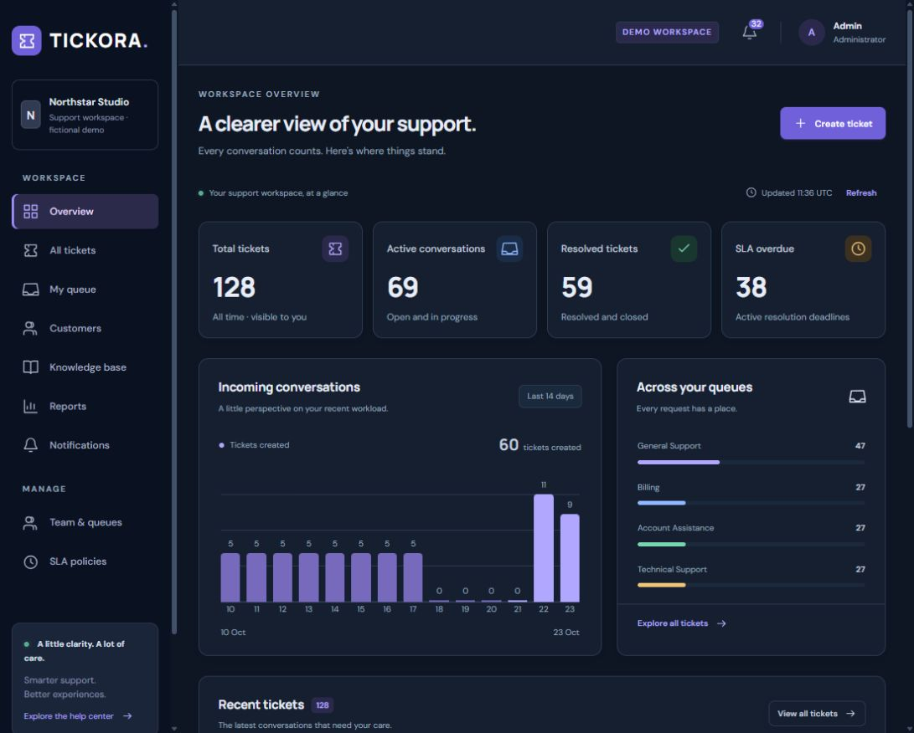
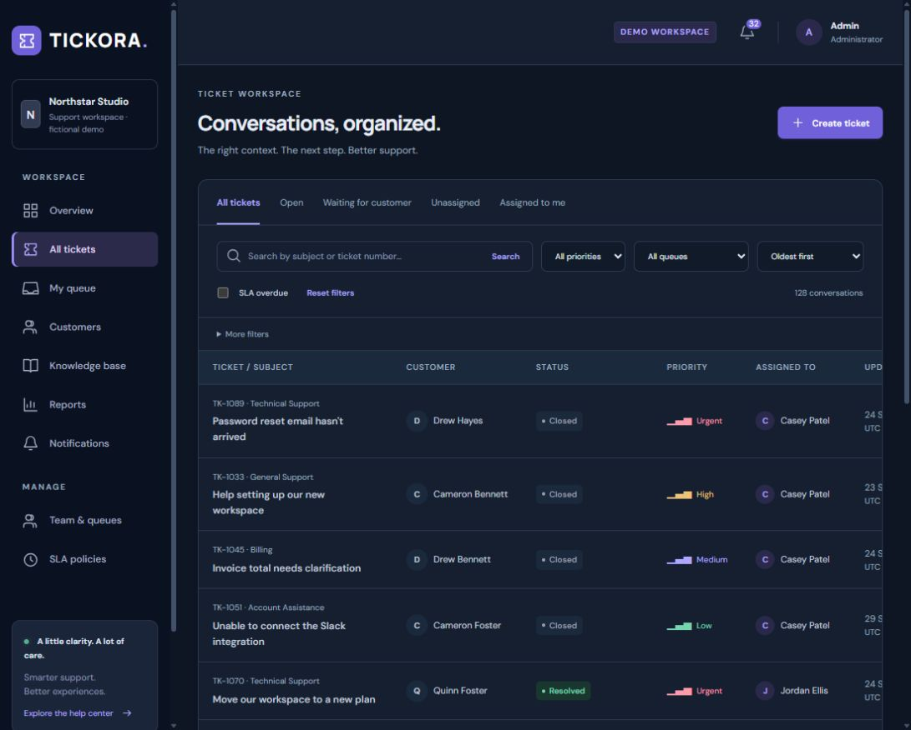
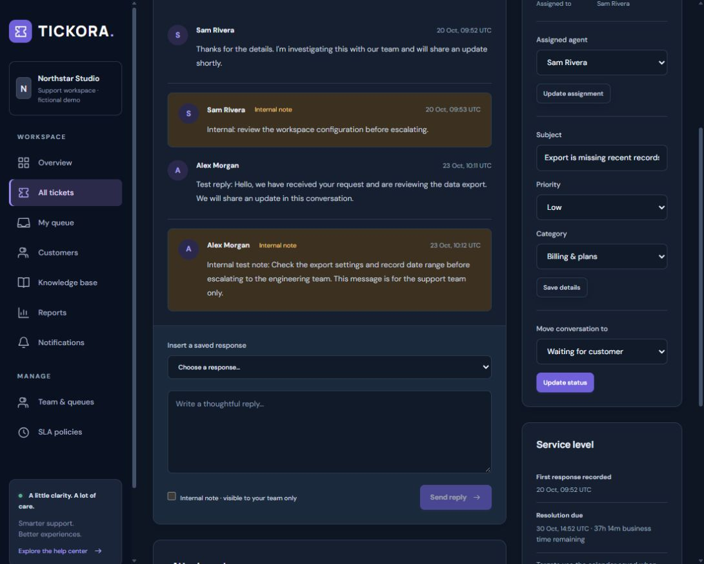
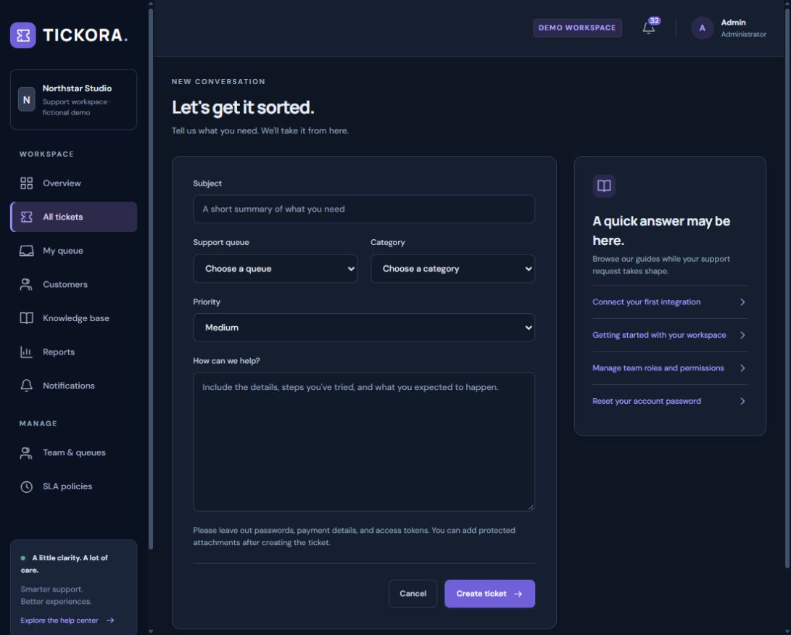
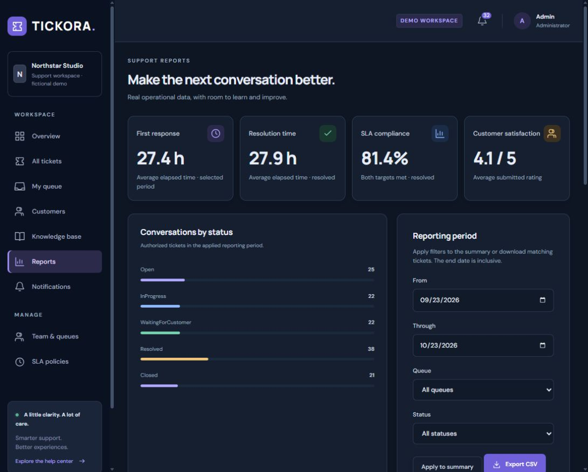
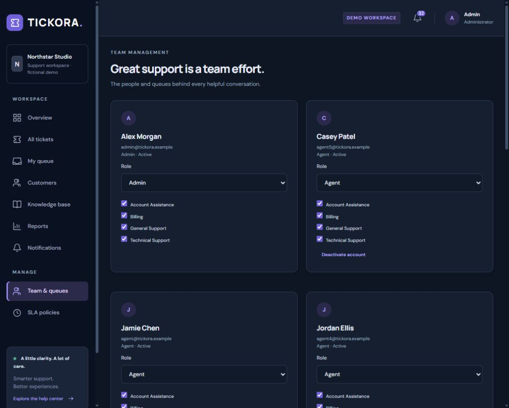

# TICKORA

**Smarter Support. Better Experiences.**

A helpdesk and support management platform built with C# and .NET 10. TICKORA brings customer conversations, private team notes, queue ownership, business-time SLAs, knowledge articles, and operational reporting into one responsive dark workspace.

| Application | Persistence | Identity and notifications | Interface |
| --- | --- | --- | --- |
| ASP.NET Core 10 · Blazor Interactive Server | EF Core · SQL Server 2022 | ASP.NET Core Identity · SignalR | Reusable Razor components · responsive dark theme |

**Verified locally:** 87 test cases passed: 48 unit, 29 integration, and 10 browser cases, with no skips when the required infrastructure was enabled. Responsive checks covered 320, 390, 768, and 1440px widths. These are recorded local results, not a claim of a remote CI run or production certification. See the [quality review](docs/quality-review.md) and [delivery report](docs/delivery-report.md).

[Product tour](#product-tour) · [Capabilities](#capabilities) · [Quick start](#quick-start) · [Configuration](#configuration) · [Architecture](#architecture) · [Testing](#testing-and-verification) · [Deployment](#deployment-and-operations) · [Troubleshooting](#troubleshooting)

## Product tour

The following screenshots were captured from the running application using the fictional Northstar Studio workspace. All project-owned content, sample conversations, and documentation use English.

[Download all six screenshots as a ZIP](artifacts/Tickora-Project-Screenshots.zip)

### 1. Workspace overview

Track total tickets, active conversations, resolutions, overdue work, incoming volume, and queue distribution from a shared operational dashboard.



### 2. Ticket inbox

Find conversations using subject or ticket number, queue and priority filters, personal views, sorting, and server-side pagination.



### 3. Conversation and private team notes

Keep customer-facing replies and internal investigation notes in the same staff workspace. Internal notes have an explicit label and a distinct amber surface; customer views exclude them.



### 4. Ticket creation

Capture the subject, support queue, category, priority, and request details while suggesting relevant knowledge articles.



### 5. Reports and service performance

Review response and resolution durations, SLA compliance, satisfaction, ticket distribution, workload, and trends. Apply a reporting period and export authorized results to CSV.



### 6. Team and queue management

Manage support roles, account availability, and queue memberships from the administrator workspace.



## Capabilities

### Ticket lifecycle

- Create and categorize requests with queue routing, priorities, and submission identifiers.
- Assign eligible agents, update triage details, and move tickets through **Open → In progress → Waiting for customer → Resolved → Closed**, subject to allowed transitions.
- Reopen resolved or closed conversations while preserving their activity history.
- Send public replies, add private notes, insert saved responses, and attach protected files.
- Collect a customer rating and comment after resolution; feedback remains available after a page reload.
- Protect concurrent changes with SQL rowversion checks and return a conflict for stale writes.

### Service levels and reporting

- Calculate deadlines using business calendars, breaks, weekends, holidays, special schedules, and time-zone transitions.
- Snapshot each ticket's SLA settings so later policy edits preserve historical targets.
- Pause resolution while waiting when the captured policy permits; first-response deadlines continue independently.
- Monitor upcoming and breached targets and route alerts to eligible staff.
- Aggregate authorized data in SQL and export filtered CSV results with spreadsheet formula-prefix neutralization.

### Knowledge and notifications

- Publish and search plain-text knowledge articles, show related guides, and suggest articles during ticket creation.
- Create, edit, archive, and restore saved responses for the staff composer.
- Persist notifications in SQL, expose unread counts and paginated history, and mark owned notifications as read.
- Deliver user-specific notification hints, with a 30-second recovery refresh. Private notes and private uploads do not send customer hints.

### Roles and access

| Role | Ticket visibility | Main responsibilities |
| --- | --- | --- |
| Customer | Own tickets only | Submit requests, reply, upload public attachments, reopen conversations, close resolved tickets, and submit feedback |
| Agent | Tickets in current queue memberships | Triage, assignment, public replies, internal notes, private files, customer context, knowledge management, and authorized reports |
| Administrator | Global workspace access | Staff workflows plus account roles, activation, memberships, queues, categories, and SLA policies |

Published knowledge articles are also available through the public help center. Authorization is enforced by the server and resource queries, independently of which controls the UI displays.

## Quick start

Run commands from the repository root. The examples use PowerShell 7; use equivalent environment-variable syntax in other shells.

### Prerequisites

| Setup | Requirements |
| --- | --- |
| Docker development | Docker Engine/Desktop with Linux containers and Docker Compose |
| Native application or local tests | .NET 10 SDK and access to SQL Server |
| Windows convenience scripts | PowerShell 7, WSL with a working Docker Engine, and an installed .NET 10 SDK |
| Browser journeys | A running, migrated, seeded development application and Playwright Chromium or installed Microsoft Edge |

`global.json` selects .NET 10 and permits later .NET 10 feature bands. SQL Server containers use `linux/amd64` and require a supported x86-64 host; use an external SQL Server or compatible Azure SQL database when a local SQL container is unsuitable.

### Option A — Docker Compose

Create `.env` on the first checkout, keeping an existing file intact:

```powershell
if (!(Test-Path .env)) { Copy-Item .env.example .env }
```

Edit `.env` and replace both example values with distinct strong development passwords before continuing. The file is ignored by version control.

```powershell
docker compose config --quiet
docker compose build tickora-web
docker compose up -d tickora-sqlserver --wait
docker compose run --rm tickora-web --migrate --seed
docker compose up -d tickora-web --wait
```

Open **[http://localhost:5180](http://localhost:5180)**. The base Compose file binds SQL Server to loopback port `1433` and the application to loopback port `5180`.

| Persistent volume | Contents |
| --- | --- |
| `tickora-sql` | SQL Server database files |
| `tickora-files` | Private attachments, data-protection keys, and development reset-email files |

Normal startup does not apply migrations or seed data. Run those steps explicitly when needed.

```powershell
docker compose logs --tail=100 tickora-web
docker compose down
```

`docker compose down` retains named volumes unless volume removal is explicitly requested. The Compose environment is configured for local Development.

### Option B — Windows and WSL convenience scripts

On the configured Windows environment:

```powershell
./scripts/Start-Tickora.ps1
```

The script discovers the WSL address, starts persistent SQL Server, builds the solution, applies pending migrations, seeds missing development data, and launches the native web process in the background. If `.env` is absent, it generates separate random SQL and demo passwords. Existing passwords and application data are preserved. Use the following commands individually as needed:

```powershell
./scripts/Start-Tickora.ps1 -DatabaseOnly
./scripts/Start-Tickora.ps1 -SkipBuild
./scripts/Test-Tickora.ps1
./scripts/Stop-Tickora.ps1 -KeepDatabase
./scripts/Stop-Tickora.ps1
```

| Option | Behavior |
| --- | --- |
| `-DatabaseOnly` | Start SQL Server without starting the native web app |
| `-SkipBuild` | Reuse current binaries; rebuild first after source changes |
| `-WslDistribution` | Override the default `Ubuntu-24.04` distribution |
| `-KeepDatabase` on the stop script | Stop the native web process while keeping the database running |

The WSL override discovers a private address where Windows loopback forwarding is unavailable. It shares the native `App_Data` directory with the optional container web host, which uses port `5181`. The override requires Compose 2.24.4+ for `!override`. Runtime logs, process IDs, and non-secret addresses are kept under ignored `.tools/`.

The start script checks `%LOCALAPPDATA%\Tickora\dotnet` before using `dotnet` from `PATH`. To use that per-user SDK directly in a terminal:

```powershell
$env:DOTNET_ROOT = "$env:LOCALAPPDATA\Tickora\dotnet"
$env:PATH = "$env:DOTNET_ROOT;$env:PATH"
dotnet --info
```

### Option C — Existing SQL Server

```powershell
dotnet restore Tickora.slnx
dotnet tool restore
dotnet build Tickora.slnx

$env:ASPNETCORE_ENVIRONMENT = 'Development'
$env:ConnectionStrings__TickoraDb = Read-Host 'SQL Server connection string' -MaskInput
$env:Demo__Password = Read-Host 'Initial development demo password' -MaskInput

dotnet run --project src/Tickora.Web --no-build -- --migrate --seed
dotnet run --project src/Tickora.Web --no-build
```

Connection-string shape for a local development server:

```text
Server=localhost,1433;Database=TickoraDb;User ID=YOUR_USER;Password=YOUR_PASSWORD;TrustServerCertificate=true
```

An already installed Windows LocalDB instance can use:

```text
Server=(localdb)\MSSQLLocalDB;Database=TickoraDb;Integrated Security=true;TrustServerCertificate=true
```

LocalDB is not installed by this repository. The app cannot authenticate users or load ticket data without a working database, even though anonymous account forms can render.

### Development accounts

| Role | Email |
| --- | --- |
| Administrator | `admin@tickora.example` |
| Agent | `agent@tickora.example` |
| Customer | `customer@tickora.example` |

The initial password is supplied through `DEMO_PASSWORD` for Compose/scripts or `Demo__Password` for native execution at the time of seeding. There is no built-in password. Changing that setting later does not reset an existing account.

The initial fictional dataset contains 108 tickets, five agents, thirty customers, four queues, five categories, six articles, replies, notes, feedback, saved responses, and notifications. Browser tests add named development records, so counts grow after testing. Seeding is Development-only, preserves existing data, and should not run concurrently.

## Configuration

ASP.NET Core environment variables use double underscores for nested keys. Direct `dotnet run` does not automatically load the root `.env`; Compose and the convenience scripts consume it.

| Setting | Purpose / default |
| --- | --- |
| `ConnectionStrings__TickoraDb` | SQL Server connection string for the web host and migrations |
| `Demo__Password` | Initial demo password for explicit development seeding |
| `SQL_PASSWORD` / `DEMO_PASSWORD` | Root `.env` values consumed by Compose and scripts |
| `ASPNETCORE_ENVIRONMENT` | Use `Development` for local setup and seeding |
| `ASPNETCORE_URLS` | Native listener override; the launch profile uses `http://localhost:5180` |
| `PublicOrigin` | Trusted reset-link origin; HTTPS is required outside Development |
| `AllowedHosts` | Accepted hostnames; local configuration uses `localhost;127.0.0.1` |
| `Storage__Root` | Private attachment directory; defaults beneath the web host's `App_Data` |
| `Sla__MonitorEnabled` | Enable the SLA worker; defaults to `true` |
| `Sla__ScanSeconds` | Scan interval; defaults to `60` |
| `Sla__WarningMinutes` | Warning horizon; defaults to `30` elapsed minutes |
| `RateLimits__AccountPermitLimit` | Account-request limit per IP; defaults to `10` per minute |
| `Smtp__Host`, `Smtp__Port` | SMTP host and port; default port is `587` |
| `Smtp__Username`, `Smtp__Password`, `Smtp__From` | SMTP credentials and sender for TLS reset-email delivery |
| `Smtp__DevelopmentOutbox` | Optional private development reset-email directory |

In Development without SMTP, reset messages are written to `src/Tickora.Web/App_Data/mail/` or `/app/App_Data/mail/` in Docker. These files contain sensitive reset links and are not served publicly. Production reset delivery requires SMTP configuration.

## Architecture

TICKORA is a modular monolith with four production projects. Blazor components and protected HTTP endpoints invoke the same application workflows.

| Project | Responsibility |
| --- | --- |
| `Tickora.Domain` | Entities, allowed transitions, business calendars, and SLA arithmetic; no framework dependencies |
| `Tickora.Application` | Authorized use cases, validation, DTOs, and focused persistence/query contracts |
| `Tickora.Infrastructure` | EF Core SQL Server, Identity persistence, queries, migrations, private storage, seeding, and SLA monitoring |
| `Tickora.Web` | Composition root, Razor components, account forms, REST endpoints, and SignalR |

Each operation creates and disposes its own database context. A live UI circuit does not hold a shared EF context. Related ticket changes, messages, activity, pauses, and notification rows commit transactionally. SQL rowversion protects concurrent updates.

### Component organization

| Area | Main components |
| --- | --- |
| Shell | `DashboardLayout`, `WorkspaceSidebar`, `WorkspaceTopbar`, `PublicLayout`, `NotificationBell` |
| Tickets | `TicketTable`, `TicketProperties`, `SlaIndicator`, `TicketTimeline`, `TicketFeedback` |
| Conversations | `MessageThread`, `MessageComposer`, `AttachmentList` |
| Administration | `TeamMemberCard`, `SlaPolicyEditor` |
| Shared interface | `AppButton`, `PageHeader`, `MetricCard`, badges, pagination, charts, loading, empty, and error states |

Pages coordinate loading, busy/error state, service calls, and concurrency versions. Feature components receive typed parameters and callbacks. Shared CSS tokens define dark surfaces, semantic colors, typography, keyboard focus, and responsive behavior.

### Repository map

```text
Tickora.slnx
src/
  Tickora.Domain/
  Tickora.Application/
  Tickora.Infrastructure/
  Tickora.Web/
tests/
  Tickora.UnitTests/
  Tickora.IntegrationTests/
  Tickora.E2ETests/
scripts/                         Startup, shutdown, and complete validation
infrastructure/docker/           Container build and migration SQL
artifacts/project-screenshots/    Six product screenshots embedded above
docs/                            Architecture, SLA rules, reviews, and brief
.github/workflows/ci.yml          Automated validation pipeline definition
```

See [architecture and implementation decisions](docs/architecture.md) for transaction boundaries, persistence, identity, files, and notification tradeoffs.

## SLA behavior

| Priority | First response | Resolution |
| --- | --- | --- |
| Low | 1,440 business minutes | 4,320 business minutes |
| Medium | 480 business minutes | 1,920 business minutes |
| High | 120 business minutes | 480 business minutes |
| Urgent | 30 business minutes | 240 business minutes |

The default calendar is Monday–Friday, 09:00–17:00 in `Etc/UTC`, with a 12:00–13:00 break: seven business hours per working day. Administrators edit policies and calendars at `/admin/sla`.

Only the first public staff reply qualifies as a first response. Internal notes do not count. Waiting can pause resolution according to the ticket's snapshot; it does not pause first response. Reopening starts a new resolution cycle while retaining first-response history and the original policy snapshot. Reports describe the latest resolution cycle, and average durations are labeled elapsed hours. See [SLA rules](docs/sla-rules.md) for calendar validation and monitoring details.

## Security and API

- Identity manages password hashing, lockout, cookies, reset tokens, and security stamps. Account forms use antiforgery-protected HTTP submissions under `/account/actions`.
- Workflows recheck the active account, security stamp, roles, and current queue memberships. Interactive authentication state is revalidated each minute.
- Ticket visibility is filtered in SQL. Internal messages, activity, and attachment metadata are excluded from customer queries.
- Writes validate resource access and concurrency versions. Stale ticket writes return `409 Conflict`.
- Files stay outside `wwwroot`. Downloads enforce ownership and visibility; uploads allow PNG, JPEG, PDF, or strict UTF-8 text up to **5 MB**, with extension/signature validation and generated keys.
- Articles render as encoded plain text. Notification hints contain no conversation body or private note text.

### API entry points

| Method | Path | Purpose |
| --- | --- | --- |
| `GET` | `/api/v1/antiforgery` | Obtain a token for authenticated writes |
| `GET`, `POST` | `/api/v1/tickets` | List authorized tickets or create a ticket |
| `GET`, `PATCH` | `/api/v1/tickets/{id}` | Read or update an authorized ticket |
| `POST` | `/api/v1/tickets/{id}/reply` | Add a public reply or authorized internal note |
| `POST` | `/api/v1/tickets/{id}/assign` | Update staff assignment |
| `POST` | `/api/v1/tickets/{id}/transition` | Apply an allowed transition |
| `GET` | `/api/v1/tickets/{id}/activities` | Read authorized activity history |
| `POST` | `/api/v1/tickets/{id}/feedback` | Submit customer feedback |
| `POST` | `/api/v1/tickets/{id}/attachments` | Upload a protected attachment |
| `GET` | `/api/v1/tickets/{id}/attachments/{attachmentId}` | Download an authorized attachment |
| `GET` | `/api/v1/notifications` | Read the current user's notification history |
| `POST` | `/api/v1/notifications/{id}/read` | Mark an owned notification as read |
| `GET` | `/api/v1/knowledge/articles` | Search published articles |
| `GET` | `/api/v1/knowledge/articles/{slug}` | Read a published article |
| `GET` | `/api/v1/reports/export` | Export authorized, filtered tickets to CSV |

For cookie-authenticated API writes:

1. Sign in through the account form and retain the authentication cookies.
2. Request `/api/v1/antiforgery` using the same cookies.
3. Send its token in `X-CSRF-TOKEN` on write requests.
4. Include the latest base64 rowversion in the relevant workflow payload.

The authenticated hub at `/hubs/notifications` emits `notificationsChanged` only for the authenticated user. Independent clients should reconnect and retrieve authoritative rows from `/api/v1/notifications`.

## Testing and verification

Recorded local results from the 23 October 2026 review:

| Suite / check | Result |
| --- | --- |
| Unit tests | 48 passed |
| Integration tests | 29 passed, with real SQL Server enabled |
| Browser cases | 10 passed: nine-case suite plus a focused mobile search/pagination case |
| Build | Zero warnings and errors |
| Formatting | `dotnet format --verify-no-changes` passed |
| Responsive matrix | 11 pages at 320, 390, 768, and 1440px, plus ticket-detail checks |
| Conversation journeys | Customer/agent workflows at 390 and 1440px, including private-note/file isolation and persisted feedback |

Checks used Chromium/Edge and the in-app browser with viewport emulation. Physical mobile devices, Safari/Firefox, and production load testing are outside the recorded review. Results and screenshots are described in the [quality review](docs/quality-review.md).

### Complete validation on the configured Windows environment

```powershell
./scripts/Test-Tickora.ps1
```

This builds the solution, starts the app and SQL Server, enables all infrastructure-dependent suites, uses installed Edge, and checks the web log for unexpected errors.

### Standard developer checks

```powershell
dotnet build Tickora.slnx
dotnet test Tickora.slnx
dotnet format Tickora.slnx --verify-no-changes --no-restore
dotnet publish src/Tickora.Web -c Release
```

SQL-backed and browser cases are opt-in. Default `dotnet test` skips those cases unless their environment flags and prerequisites are configured; skipped cases are not evidence of successful integration testing.

### Real SQL integration tests

The suite creates and drops only an isolated `TickoraTest_<guid>` database and private temporary files. The connection needs permission to create that temporary database.

```powershell
$env:TICKORA_SQL_TESTS = '1'
$env:TICKORA_TEST_CONNECTION = Read-Host 'SQL test connection string' -MaskInput
dotnet test tests/Tickora.IntegrationTests
```

Alternatively, use Testcontainers on a compatible Docker host:

```powershell
$env:TICKORA_TESTCONTAINERS = '1'
dotnet test tests/Tickora.IntegrationTests
```

### Browser tests

Start a migrated, seeded development app first. Then install Chromium and enable authenticated journeys and anonymous rendering checks:

```powershell
dotnet build tests/Tickora.E2ETests
pwsh tests/Tickora.E2ETests/bin/Debug/net10.0/playwright.ps1 install chromium

$env:TICKORA_E2E = '1'
$env:TICKORA_SMOKE = '1'
$env:TICKORA_BASE_URL = 'http://localhost:5180'
$env:Demo__Password = Read-Host 'Password used for the seeded demo accounts' -MaskInput
$env:TICKORA_SCREENSHOTS = Join-Path (Get-Location) 'docs/screenshots'

dotnet test tests/Tickora.E2ETests --no-build
```

To use installed Edge instead of bundled Chromium, configure the custom rendering checks and the Playwright test runner:

```powershell
$env:TICKORA_BROWSER_CHANNEL = 'msedge'
dotnet test tests/Tickora.E2ETests --no-build -- 'Playwright.LaunchOptions.Channel=msedge'
```

Browser journeys create fictional development tickets, files, articles, and saved responses. Anonymous login rendering checks can run separately without a working SQL Server:

```powershell
$env:TICKORA_SMOKE = '1'
dotnet test tests/Tickora.E2ETests --no-build --filter 'FullyQualifiedName~LoginRenderingTests'
```

### Continuous integration

The checked-in [GitHub Actions workflow](.github/workflows/ci.yml) defines restore, Release build, formatting, unit and SQL tests, publishing, Docker build/migration/startup, and Chromium browser validation. A workflow definition is included; a successful remote run is not asserted by this README.

## Deployment and operations

### Health and diagnostics

| Endpoint / location | Purpose |
| --- | --- |
| `/health/live` | Process liveness without a database dependency |
| `/health/ready` | Database connectivity and confirmation of no pending migrations |
| `/openapi/v1.json` | API description, exposed only in Development |
| `.tools/web.log`, `.tools/web.error.log` | Native host output from the Windows script |
| `.tools/local.json` | Non-secret local connection addresses |
| `docker compose logs tickora-web` | Container host logs |

### Database lifecycle

Apply migrations explicitly and review schema changes before deployment. The repository includes an idempotent script at `infrastructure/docker/migrate.sql`.

```powershell
dotnet tool restore
dotnet ef database update --project src/Tickora.Infrastructure --startup-project src/Tickora.Web
dotnet ef migrations has-pending-model-changes --project src/Tickora.Infrastructure --startup-project src/Tickora.Web
```

After an intentional schema change:

```powershell
dotnet ef migrations add YourChange --project src/Tickora.Infrastructure --startup-project src/Tickora.Web --output-dir Persistence/Migrations
dotnet ef migrations script --idempotent --project src/Tickora.Infrastructure --startup-project src/Tickora.Web --output infrastructure/docker/migrate.sql
```

### Production preparation

Before deploying beyond local Development, configure:

- HTTPS hosting, a trusted HTTPS `PublicOrigin`, deployment-specific `AllowedHosts`, and trusted reverse-proxy forwarding where applicable.
- A least-privilege SQL application identity, trusted database certificates, and externally managed secrets.
- Persistent private attachment storage and protected data-protection keys, shared appropriately across replicas.
- SMTP delivery, database/file backups with restore procedures, monitoring, and operational retention policies.
- Upload malware scanning, quotas, and orphan-file reconciliation where required; signature checks are not antivirus scanning.
- Workload and deployment security assessment for the intended environment.

The SLA worker uses a SQL application lock to prevent concurrent scan ownership. Notification rows are durable, but immediate hints are best-effort and there is no transactional outbox. Multiple web replicas require shared files/keys and appropriate connection routing for Interactive Server sessions; badges recover missed cross-replica hints through SQL polling.

Current boundaries include buffered CSV exports, no separate conversation-message pagination, calendar JSON editing rather than a dedicated calendar designer, and reporting for the latest resolution cycle. See the [delivery report](docs/delivery-report.md) for verified scope and deployment responsibilities.

## Troubleshooting

| Symptom | Check / action |
| --- | --- |
| No .NET SDK is found | Use a .NET 10 SDK; on the configured machine, expose the per-user SDK using the `DOTNET_ROOT`/`PATH` example above |
| SQL Server is unreachable | Check container health, server/port, and connection string; use the WSL script where private-address routing is required |
| Port 5180 is already in use | Run one local web host on that port; stop the native instance before starting the base Compose web service |
| Sign-in fails after changing `.env` | Seeded accounts retain their original password; changing configuration does not reset them |
| A write returns 409 | Reload the resource, review concurrent changes, and resubmit with the latest version |
| A resource returns 403 or 404 | Confirm the role, ownership, and active queue memberships; internal content is restricted to authorized staff |
| Browser executable is missing | Install Chromium or configure both Edge channel settings shown above |
| Integration/browser cases are skipped | Enable the test flags and provide the database, running app, credentials, and browser |
| Reset email is not delivered | Check SMTP settings or inspect the private development outbox when SMTP is absent |
| Attachment metadata exists but a file is missing | Confirm the expected persistent private storage; SQL metadata alone does not contain file bytes |

## Documentation and development conventions

| Document | Contents |
| --- | --- |
| [Architecture](docs/architecture.md) | Layers, request flow, persistence, identity, notifications, and files |
| [SLA rules](docs/sla-rules.md) | Calendars, response qualification, pauses, reopen cycles, and monitoring |
| [Quality review](docs/quality-review.md) | Component extraction, fixes, responsive coverage, and validation evidence |
| [Delivery report](docs/delivery-report.md) | Executed local verification, boundaries, and deployment limits |
| [Implementation brief](docs/implementation-brief.md) | Original product requirements and scope reference |
| [Project guidance](AGENTS.md) | English-only conventions for code, examples, documentation, and screenshots |

Keep business rules in Domain/Application, resource-filtered persistence in Infrastructure, and presentation in focused Razor components. Add meaningful regression coverage for behavior changes, run the relevant enabled suites, and update documentation/screenshots when workflows change. Never commit `.env`, private `App_Data`, reset links, or runtime credentials.
